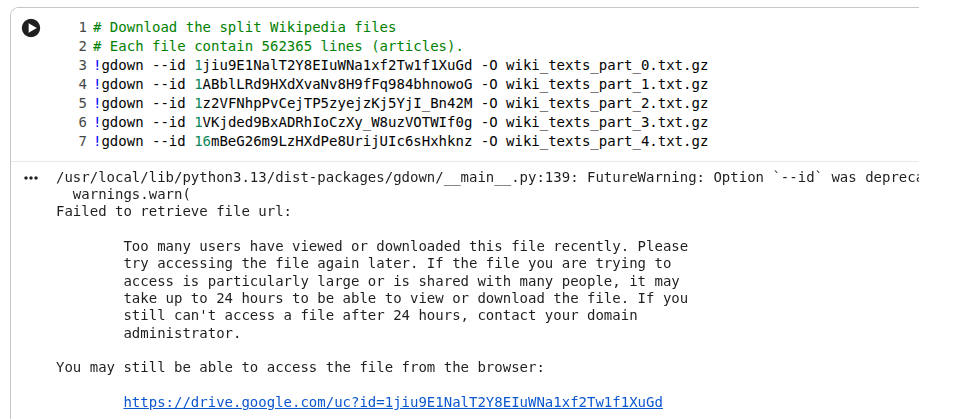

各位同學好，這裡補充一些在 HW1 可能出現的疑問以及需要遵守的規則（update: 9/24 12:18）：

在 colab 中，如果沒辦法成功 import gensim，請在開頭執行 !pip install gensim 安裝套件，如果是在 local 跑也請寫在 requirements.txt 中。
Report 請用 markdown 直接寫在 notebook 中，不需再額外繳交 report 的 .pdf 等文檔。
Report 的第 3 題要求要附上實驗的程式碼，請在 3.2 介紹 corpus 時一同附上你找的 corpus 的 data source link（助教們會驗證）。
所有 code block 程式碼 （包含 Report 第 3 題）請在 notebook 中保留所有 terminal 的輸出結果，否則我們會斟酌扣分。
作業請簡報 P33 頁的格式繳交：請繳交一個 .zip 檔， 包含你的 notebook (.ipynb) 以及 requirements.txt（必繳）。
如果沒有 requirements.txt，我們會扣除 requirements.txt 的分數。
可以使用 !pip list --format=freeze > requirements.txt 來產生 requirements.txt
請輸出成 .ipynb 檔，切勿轉換成 .py 繳交。
有其他疑問也歡迎同學在 slido 中提出。

各位同學好：

為了大家作業進行完成順利，這裡想再提醒幾件事情
1. 繳交期限是 10/14 午夜 12:00 以前（超過 deadline 後繳交，分數每週打九折）
2. 使用 colab 的同學，建議可以將訓練的 checkpoint 儲存並下載到電腦上（因 colab 隔天打開，儲存在雲端的資料可能會被清空）
3. 請同學們不要修改 code template 裡面既有的程式碼以及 workflow（你可以額外增加 code，但勿動既有程式碼）

若有問題，歡迎來信詢問
祝大家中秋節快樂～

同學好：
關於 Wiki Dataset 下載限流問題，這邊要麻煩同學根據 terminal 輸出的檔案連結，自行手動下載所有十個 zip file 後，再手動上傳到 colab 裡面 （本地跑的同學們則只須手動下載到電腦）
（使用 colab 的同學，請不要下載我們提供的大檔案，因上傳到 colab 上一樣會被擋住）

想分享自己試過成功的方法

先到助教給的大檔案連結 https://drive.google.com/file/d/1t4cqlZEgiRJCJJOzHeja3AjU1jTWiDRa/view?usp=sharingLinks to an external site. 

點左上角「檔案」選單，新增捷徑

在main.ipynb新增儲存格，輸入

from google.colab import drive
drive.mount('/content/drive')
新增另一個儲存格，輸入

!unzip drive/MyDrive/<path_to_wiki_texts.zip> -d /content
!rm -rf /content/__MACOSX
<path_to_wiki_texts.zip>換成捷徑所在位置，colab左側倒數第二個工具可以找檔案路徑

以上可以替代Part 3的前兩格繞過限流

如果有任何問題也歡迎大家指正，謝謝